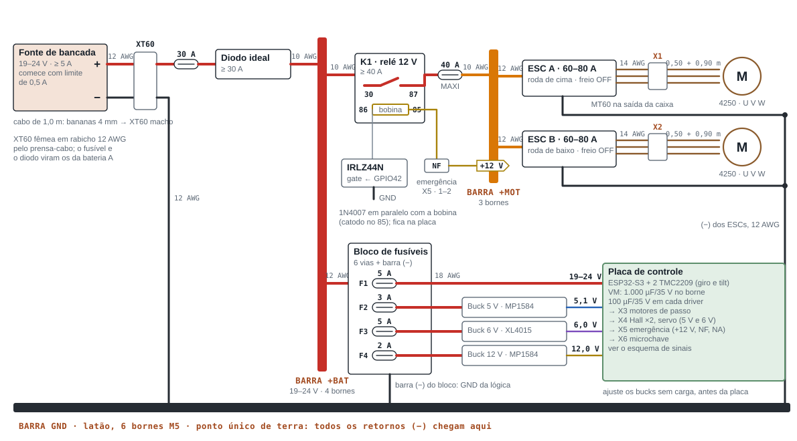
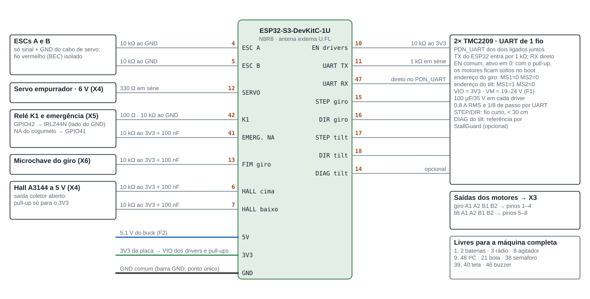
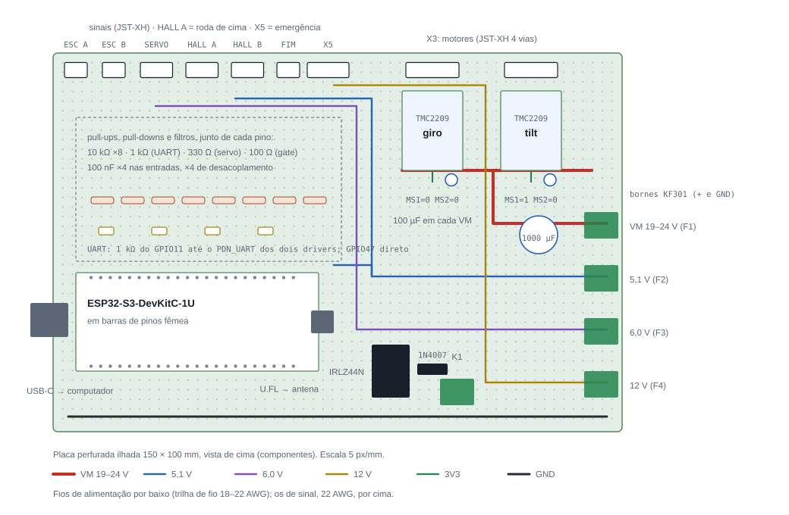
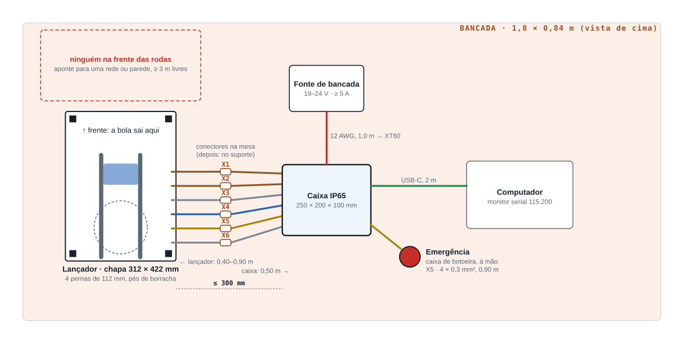

# Elétrica do MVP

Mesma arquitetura da máquina completa, com a fonte de bancada no lugar das baterias. Os pinos do ESP32, os conectores e os fusíveis já são os definitivos.

Abra o [`guia_mvp.html`](../guia_mvp.html) para ver os desenhos com as cores do tema. Os SVG desta pasta abrem direto no GitHub ou no navegador.

## 1. Potência

- Fonte de **19 a 24 V**, nunca acima: o MP1584 aceita 28 V e o TMC2209, 29 V.
- Nos primeiros testes, limite de corrente em **0,5 A**. Para girar as rodas, 5 A ou mais com a rampa de 400 rpm/s do firmware.
- **Freio dos ESCs desligado** (BLHeli_32/AM32: *Brake on stop* = off). A fonte e o diodo ideal não aceitam corrente de volta; ao frear, a energia das rodas subiria a tensão do barramento. Sem freio, as rodas param sozinhas em alguns segundos. A 5.500 rpm o motor de 400 KV gera ~13,8 V, abaixo da fonte: soltar o acelerador é seguro.
- O fio vermelho (BEC) do cabo de sinal de cada ESC fica **isolado**: o 5 V vem do buck.
- O negativo nunca é chaveado. Todos os retornos chegam à barra GND, que é o único ponto de terra.

## 2. Sinais

| GPIO | Função | Tipo | Na placa |
| --- | --- | --- | --- |
| 4 | ESC A (roda de cima) | PWM 50 Hz | 1.000–2.000 µs · 10 k ao GND |
| 5 | ESC B (roda de baixo) | PWM 50 Hz | idem |
| 6 | Hall roda de cima | entrada | 10 k ao 3V3 + 100 nF |
| 7 | Hall roda de baixo | entrada | idem |
| 10 | EN dos drivers | saída | ativo em 0 · 10 k ao 3V3 |
| 11 | UART dos drivers · TX | saída | 1 k em série até PDN_UART |
| 12 | Servo do empurrador | PWM 50 Hz | 330 Ω em série |
| 13 | Fim de curso do giro | entrada | NF ao GND · 10 k ao 3V3 + 100 nF |
| 14 | DIAG do tilt | entrada | opcional (referência por StallGuard) |
| 15 | STEP giro | saída |  |
| 16 | DIR giro | saída |  |
| 17 | STEP tilt | saída |  |
| 18 | DIR tilt | saída |  |
| 41 | Emergência (contato NA) | entrada | 10 k ao 3V3 + 100 nF |
| 42 | Relé K1 | saída | IRLZ44N no GND da bobina · 100 Ω + 10 k |
| 47 | UART dos drivers · RX | entrada | direto no PDN_UART |

Livres para a máquina completa: 1, 2 (baterias) · 3 (rádio 433) · 8 (agitador) · 9, 48 (I²C) · 21 (sensor de bola) · 38 (semáforo) · 39, 40 (tela) · 46 (buzzer).

## 3. Placa de controle

Monte nesta ordem, testando cada etapa com a fonte limitada em 0,5 A:

1. Bornes KF301 e a trilha de GND. Confira continuidade.
2. Barras de pinos fêmea do ESP32 e dos drivers (os módulos ficam removíveis).
3. Resistores e capacitores de cada entrada, junto do pino.
4. IRLZ44N, 1N4007 (catodo no lado do +12 V) e o borne do K1.
5. Conectores JST-XH de sinal e de motor.
6. Capacitores eletrolíticos: 1.000 µF no borne VM, 100 µF em cada driver, com a polaridade certa.
7. Jumper de endereço: MS1 do driver do tilt no 3V3; os outros MS no GND.

## 4. Bancada e cabos

A caixa fica a até 30 cm da chapa. Cada cabo entre os dois é feito de **dois rabichos** com o conector no meio: o do lançador (saindo do motor ou sensor) termina no plugue; o da caixa (saindo da placa pelo prensa-cabo) termina no soquete de painel. Os comprimentos são os da máquina completa: quando os andares forem montados, o soquete vai para o suporte de conectores do andar e nenhum fio é refeito.

| Conector | Tipo | Função | Pinos | Rabicho do lançador | Rabicho da caixa |
| --- | --- | --- | --- | --- | --- |
| X1 | MT60 | Roda de cima | 1 U · 2 V · 3 W | 3 × 14 AWG, 0,90 m | 3 × 14 AWG, 0,50 m |
| X2 | MT60 | Roda de baixo | 1 U · 2 V · 3 W | 3 × 14 AWG, 0,90 m | 3 × 14 AWG, 0,50 m |
| X3 | GX16-8 | Passo: giro e tilt | 1 giro A1 · 2 giro A2 · 3 giro B1 · 4 giro B2 · 5 tilt A1 · 6 tilt A2 · 7 tilt B1 · 8 tilt B2 | 4 × 0,3 mm²: giro 0,45 m, tilt 0,80 m | 8 × 0,3 mm², 0,50 m |
| X4 | GX16-8 | Cabeça | 1 +5 V · 2 GND · 3 Hall cima · 4 Hall baixo · 5 +6 V servo · 6 GND servo · 7 sinal servo · 8 ref. tilt (livre) | 8 × 0,5 mm², 0,90 m | 8 × 0,5 mm², 0,50 m |
| X5 | GX16-8 | Painel (emergência) | 1 +12 V → NF · 2 NF → K1 (85) · 3 NA → GPIO41 · 4 GND · 5 liga/desliga a (livre) · 6 liga/desliga b (livre) · 7 LED +12 V (livre) · 8 reserva | 4 × 0,3 mm², 0,90 m | 8 × 0,3 mm², 0,50 m |
| X6 | GX16-8 | Sinais (fim de curso) | 1 +5 V (livre) · 2 GND · 3 TX tela (livre) · 4 RX tela (livre) · 5 semáforo (livre) · 6 fim de curso giro · 7 reserva · 8 reserva | 4 × 0,3 mm² (2 vias), 0,40 m | 8 × 0,3 mm², 0,50 m |

Ligue e desligue os conectores X3 só com a fonte desligada: soltar um motor de passo com o driver energizado queima o driver.

### Dentro da caixa

| Código | Trecho | Fio | Comprimento | Observação |
| --- | --- | --- | --- | --- |
| P1 | XT60 fêmea → fusível 30 A → diodo ideal (IN) | 12 AWG vermelho | 0,30 m | rabicho pelo prensa-cabo; depois vira a entrada da bateria A |
| P2 | XT60 (−) → barra GND | 12 AWG preto | 0,30 m | o negativo nunca é chaveado |
| P3 | Diodo ideal (OUT) → barra +BAT | 10 AWG vermelho | 0,15 m | a chave anti-faísca entra aqui depois |
| P4 | +BAT → K1 (30) | 10 AWG vermelho | 0,15 m | olhal na barra, faston no relé |
| P5 | K1 (87) → MAXI 40 A → +MOT | 10 AWG vermelho | 0,20 m |  |
| P6 | +MOT → ESC A e ESC B (+) | 12 AWG vermelho | 2 × 0,20 m | pode ser o próprio fio do ESC |
| P7 | ESC A e ESC B (−) → barra GND | 12 AWG preto | 2 × 0,25 m |  |
| P8 | +BAT → bloco de fusíveis | 12 AWG vermelho | 0,20 m |  |
| P9 | Barra (−) do bloco → barra GND | 12 AWG preto | 0,20 m | todos os GND da lógica voltam por aqui |
| P10 | F1 → borne VM da placa (+ GND) | 18 AWG vermelho e preto | 0,25 m cada | 1.000 µF no borne |
| P11 | F2 → buck 5 V → borne 5 V da placa | 18 AWG | 0,15 + 0,15 m | ajuste 5,1 V antes de ligar |
| P12 | F3 → buck 6 V → borne 6 V da placa | 18 AWG | 0,15 + 0,15 m | ajuste 6,0 V |
| P13 | F4 → buck 12 V → borne 12 V da placa | 18 AWG | 0,15 + 0,15 m | ajuste 12,0 V |
| P14 | Placa (K1 85/86) → bobina do K1 | 22 AWG | 2 × 0,25 m | 1N4007 na placa, catodo no 85 |
| P15 | Sinal + GND dos ESCs → JST da placa | cabo de servo do ESC | — | fio vermelho (BEC) isolado com termorretrátil |
| P16 | Soquetes X3–X6 → JST da placa | rabichos de 0,50 m | — | o rabicho já é o cabo da caixa |

## 5. Simulação

A pasta [`wokwi/`](wokwi/) tem o projeto para o [Wokwi](https://wokwi.com), que simula o ESP32-S3 no navegador com o mesmo programa. Instruções no `LEIAME.md` dela.
