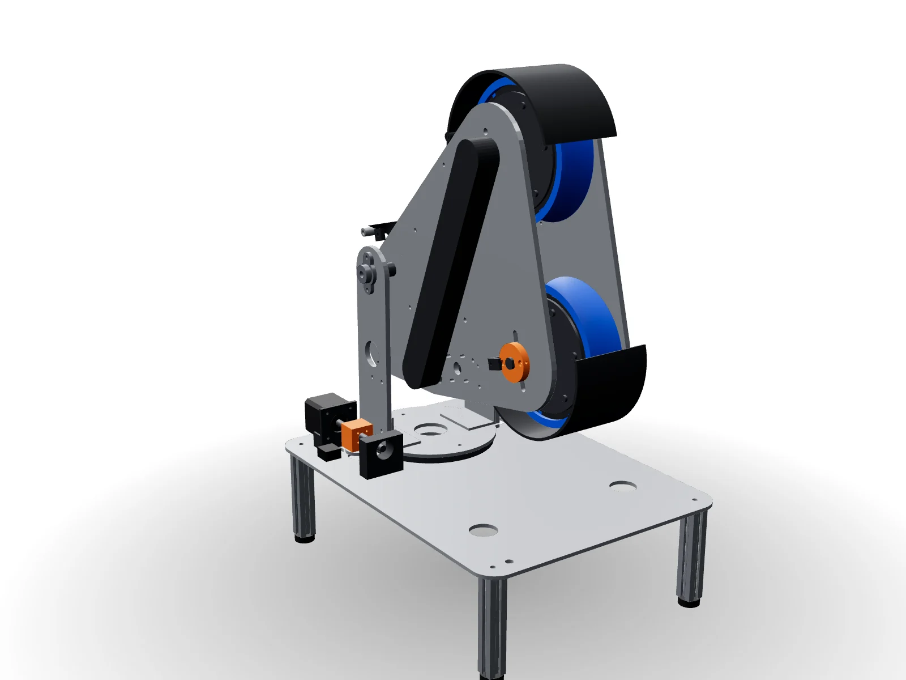

# Lançador de bolas · MVP de bancada

Esta branch tem só o que entra no MVP de bancada: a **base do andar do lançador** (alumínio 4 mm), o **giro**, a **inclinação** e a **cabeça de lançamento**. A alimentação vem de uma fonte de bancada, os comandos vêm do computador pelo USB e as bolas entram à mão no berço.

**Nada aqui é provisório.** Cada peça impressa, cortada, usinada ou comprada, cada conector e cada rabicho de fio desta lista é da máquina completa e continua nela quando o resto chegar. Só três itens são de bancada e estão marcados assim na lista: a fonte, o cabo dela com plugues banana e a caixa de botoeira da emergência.

O guia completo, com os desenhos da elétrica e todas as tabelas, está em [`guia_mvp.html`](guia_mvp.html) (abra no navegador).

## A chapa sozinha na mesa aguenta?

**Aguenta o peso com folga, mas não deve ficar deitada direto na mesa.**

- **Peso:** o MVP tem ~9,8 kg. A chapa de 4 mm, apoiada nos 4 cantos, flete menos de 0,5 mm com isso.
- **Por que não deitada:** por baixo da chapa ficam as porcas do lazy susan, do suporte do motor do giro e do mancal do fuso. A chapa ficaria apoiada nelas, balançando.
- **Como apoiar:** use os 4 postes do andar de controle (perfil 20×20, 112 mm) como pernas, com um pé de borracha M5 embaixo de cada um. São os mesmos postes que depois ligam o andar de controle ao do lançador: nada se perde.
- **Estabilidade:** o centro de massa fica perto do meio da chapa, a 27–32 cm da mesa, dentro do retângulo de 270 × 380 mm das pernas. A máquina não tomba nem com a cabeça no giro máximo.
- **Vibração:** com as rodas a milhares de rpm ela pode "andar" na mesa. Se andar, troque os pés por uma tábua de MDF de 18 mm (~450 × 350 mm) parafusada nas pernas (M5) e prenda a tábua na mesa com 2 grampos C. É o único apoio de bancada sugerido.

## Pastas

| Pasta | O que tem |
| --- | --- |
| [`1-imprimir/`](1-imprimir/) | STL e STEP das 19 peças impressas, com orientação, configuração, massa e tempo de cada uma |
| [`2-cortar/`](2-cortar/) | DXF 1:1 das 6 chapas + pranchas em PDF para o serviço de corte a laser |
| [`3-usinar/`](3-usinar/) | STEP dos eixos e o que fazer em cada um |
| [`4-comprar/`](4-comprar/) | Lista unificada (`lista_mvp.csv`): quantas peças iguais comprar de cada item |
| [`5-eletrica/`](5-eletrica/) | Esquemas de potência e sinais, placa de controle, bancada, cabos e a simulação no Wokwi |
| [`6-firmware/`](6-firmware/) | Programa do ESP32 com comandos pelo monitor serial |
| [`7-montar/`](7-montar/) | Passo a passo da montagem mecânica, da elétrica e dos primeiros testes |
| [`modelo/`](modelo/) | Montagem em STEP, GLB e imagens |
| [`cad/`](cad/) | Código CadQuery que gera tudo isso de novo |

## Ordem sugerida

1. **Comprar** o que demora: motores 4250, ESCs, NEMA17 com fuso, servo, lazy susan, mancais, polias e correias. A lista está em `4-comprar/`.
2. **Imprimir** começando pelos núcleos das rodas (as peças mais longas). Total ≈ 1,37 kg de PETG e 0,18 kg de TPU, 79–121 h de impressora.
3. **Mandar cortar** as chapas e **usinar** os eixos enquanto imprime. Confira antes as furações das peças compradas (`2-cortar/LEIAME.md`).
4. **Montar a elétrica na bancada**, sem a mecânica: fonte, barramentos, bucks, placa, um motor por vez. Teste antes no Wokwi (`5-eletrica/wokwi/`).
5. **Montar a mecânica** (`7-montar/`): base e pernas, giro, garfos, cabeça.
6. **Juntar as duas** pelos conectores X1–X6 e fazer os testes da `7-montar/`, com as rodas em rotação baixa primeiro.

## O que fica para depois

- Baterias Makita, berços, chave anti-faísca e o segundo diodo ideal (o da bateria B)
- Andar de controle (o resto dele) e andar do alimentador, cesto e carenagem
- Controle de 433 MHz, semáforo, tela, buzzer, sensor de bola e INA226
- Terceiro TMC2209 e motor do agitador
- Suporte dos conectores entre andares (vai ser redesenhado para os 6 conectores) e painel traseiro

Tudo isso entra sem mudar nada do MVP: os pinos do ESP32, os conectores, os rabichos e os fusíveis já são os da máquina completa.

## O que o MVP mudou no projeto

Ao montar a lista do MVP apareceram correções que valem para a máquina toda. Elas já estão nos arquivos desta branch; a branch `main` ainda não tem:

- **Suporte do motor do tilt:** os furos M4 saíram de dentro do furo de Ø30 do garfo e foram para 60 mm abaixo do fuso; o garfo ganhou os furos que faltavam.
- **Berço:** as barras passantes viraram 4 insertos M4 laterais, porque o braço do empurrador cruza o meio do berço.
- **Blocos das porcas:** ganharam 4 furos-guia Ø2,5 em Ø16 para a flange da porca de latão Tr8.
- **Pivô do tilt:** furo em D nas placas laterais e chato no comprimento todo dos dois semi-eixos: antes o torque da manivela chegava à cabeça só pelo atrito dos colares.
- **Semi-eixos:** os dois agora são exportados (antes só saía um STEP); a ponta do de 65 mm leva rosca M4.
- **Eixo da roda:** o nome no CAD dizia 140 mm, mas o modelo tem 134 mm; o nome foi corrigido.
- **ESC:** freio desligado: com fonte ou diodos ideais, a energia da frenagem não tem para onde ir e sobe a tensão do barramento.
- **Relé K1:** IRLZ44N (TO-220) no lugar do AO3400, mais fácil de soldar em placa perfurada.
