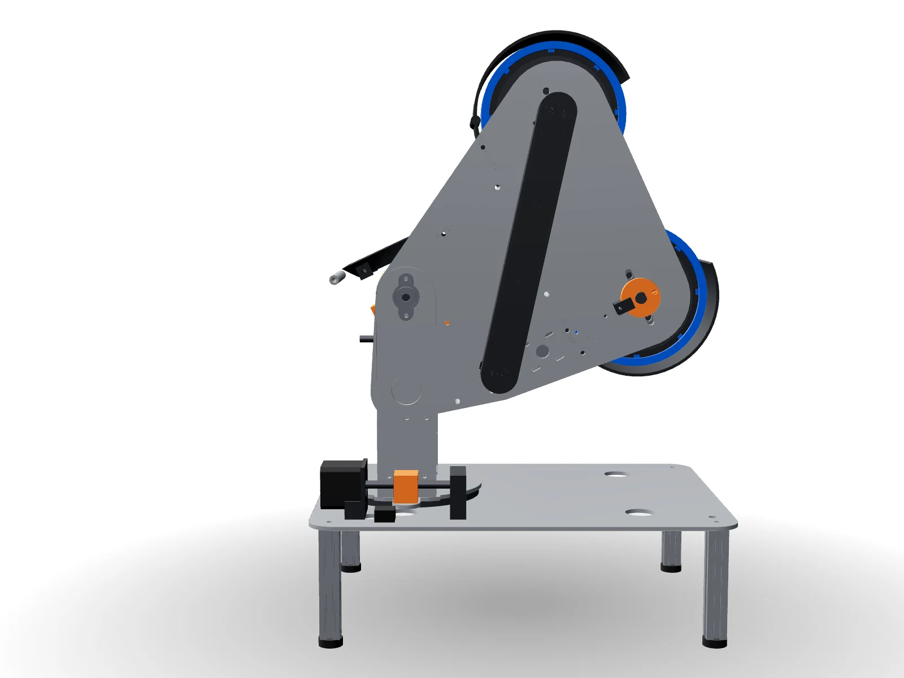
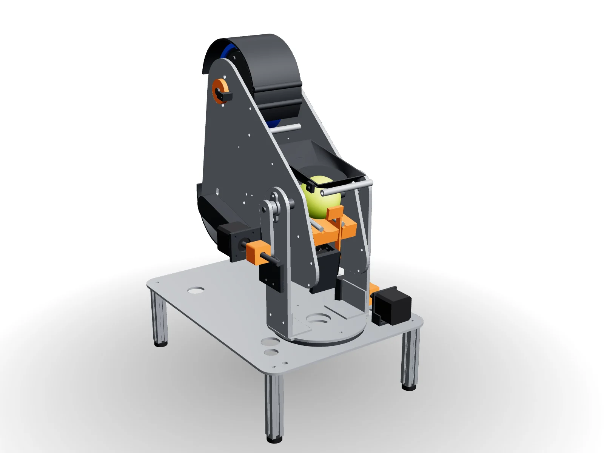
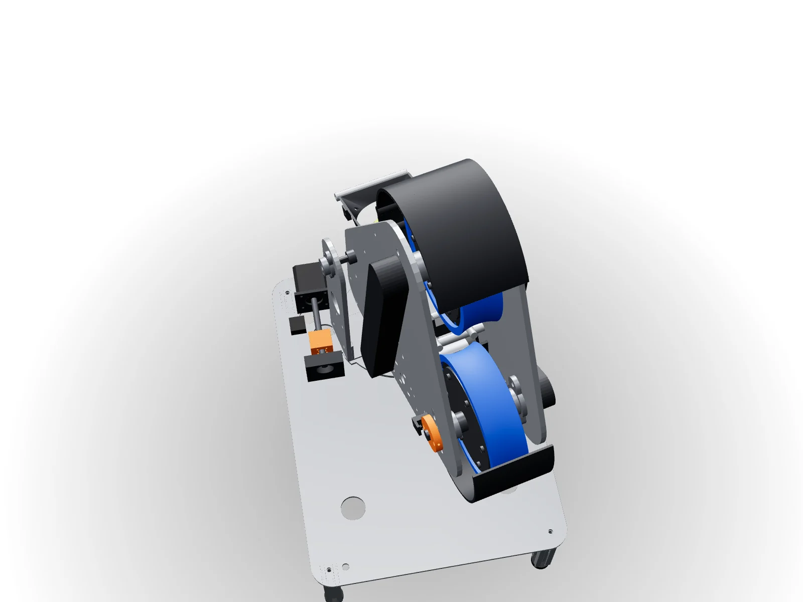

# Modelo do MVP

- `mvp_montagem.step`: montagem completa com a cabeça a 0°, para abrir no Fusion 360, FreeCAD, Onshape ou SolidWorks.
- `mvp.glb`: a mesma montagem a 15°, para visualizadores 3D (por exemplo, arraste em https://gltf-viewer.donmccurdy.com).
- `pecas_mvp.json`: nome, categoria e material de cada peça do GLB.
- Imagens:

